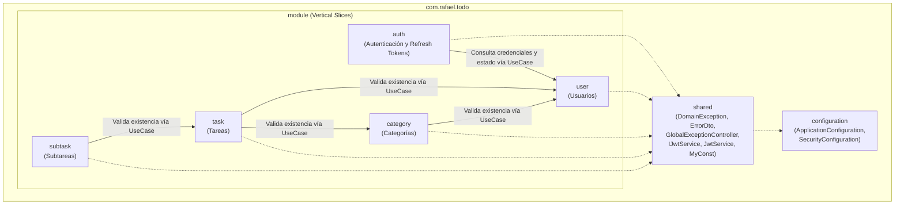
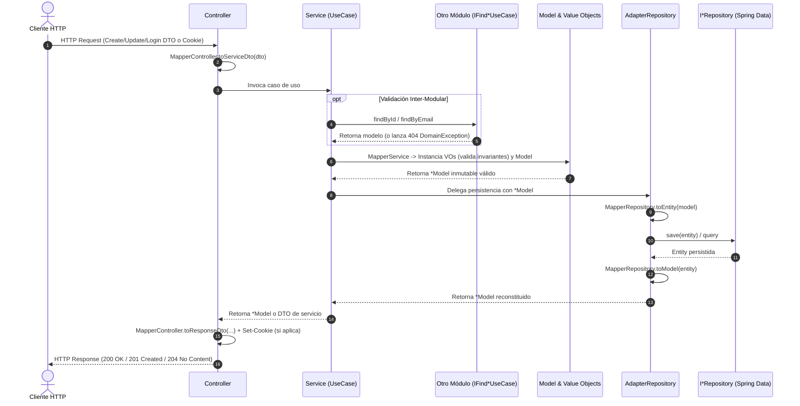

# Arquitectura del Proyecto: Modular por Capas Pragmática

El proyecto implementa una **Arquitectura Modular por Capas Pragmática (Vertical Slices)** combinada con **Modelos de Dominio Ricos Inmutables** y **Value Objects**. Este enfoque ofrece alta cohesión funcional, bajo acoplamiento entre dominios y simplicidad operativa sin caer en la sobreingeniería de una arquitectura hexagonal estricta.

---

## 1. Organización Modular (Vertical Slices)

Cada contexto de negocio vive en su propio paquete bajo `com.rafael.todo.module.<nombre_modulo>`, manteniendo sus propias capas aisladas del resto de los módulos:



---

## 2. Estructura Interna de Cada Módulo

Cada módulo (`auth`, `user`, `category`, `task`, `subtask`) respeta una estructura uniforme de paquetes:

```text
module/<nombre_modulo>/
├── controller/                   # Capa de Presentación REST
│   ├── dto/                      # Records de entrada (Create*Dto, Update*Dto, LoginDto) y salida (Response*Dto)
│   ├── mapper/                   # Transformación estática Controller DTO <-> Service DTO / Model
│   └── *Controller.java          # Endpoints HTTP (@RestController) y gestión de cookies HttpOnly
├── service/                      # Capa de Aplicación / Casos de Uso
│   ├── dto/                      # Records de transporte para casos de uso
│   ├── imp/                      # Implementación de servicios (*Service.java)
│   ├── mapper/                   # Transformación estática Service DTO -> Model
│   ├── ICreate*UseCase.java      # Contratos de casos de uso (ILoginUseCase, IRefreshTokenUseCase, etc.)
│   ├── IFind*UseCase.java        # Contrato de consulta (usado también inter-módulos)
│   ├── IUpdate*UseCase.java      # Contrato de actualización
│   └── IDelete*UseCase.java      # Contrato de eliminación
├── repository/                   # Capa de Persistencia
│   ├── adapter/                  # Contratos de adaptador e implementación (*Adapter.java)
│   ├── entity/                   # Entidades JPA (@Entity, @Table)
│   ├── mapper/                   # Transformación bidireccional Entity <-> Model
│   └── I*Repository.java         # Interfaz Spring Data JPA (JpaRepository)
├── model/                        # Capa de Dominio
│   ├── enums/                    # Enumeradores propios del dominio (si aplica)
│   ├── vo/                       # Value Objects inmutables (Java records)
│   └── *Model.java               # Modelo de dominio rico e inmutable
└── exception/                    # Fábricas de excepciones semánticas del módulo
```

---

## 3. Flujo de una Petición entre Capas



---

## 4. Reglas Arquitectónicas Fundamentales

### A. Regla de Oro: Cero Acoplamiento JPA Inter-Modular
1. **Prohibición de Relaciones JPA entre Módulos**: Ninguna entidad JPA (`RefreshTokenEntity`, `CategoryEntity`, `TaskEntity`, `SubtaskEntity`) utiliza `@ManyToOne` o `@OneToMany` apuntando a entidades de otro módulo.
2. **Persistencia por IDs Escalares**: Las entidades almacenan únicamente el identificador escalar (`UUID userId`, `Long categoryId`, `Long taskId`).
3. **Validación de Integridad Referencial en `Service`**:
   - `AuthService` inyecta `IFindUserUseCase` e `IJwtService` para verificar las credenciales y el estado activo del usuario (`findByEmail`, `findById`) al iniciar sesión o rotar tokens.
   - `CategoryService` inyecta `IFindUserUseCase` para verificar que el usuario exista antes de crear una categoría.
   - `TaskService` inyecta `IFindUserUseCase` e `IFindCategoryUseCase` para validar la existencia del usuario y la categoría (si se envía).
   - `SubtaskService` inyecta `IFindTaskUseCase` para validar la existencia de la tarea padre.
   - Si el recurso relacionado no existe o no es válido, el caso de uso lanza una `DomainException` con el código HTTP semántico correspondiente (`401`, `403`, `404`), evitando errores `DataIntegrityViolationException` (HTTP 500) en la base de datos.

### B. Aislamiento de Lógica de Negocio, Cookies HTTP y Rol de Mappers
- **`controller`**: Recibe peticiones HTTP, gestiona cookies `HttpOnly` (`ResponseCookie` en `AuthController`), delega al caso de uso y devuelve `ResponseEntity`. Cero reglas de negocio.
- **`service`**: Orquesta casos de uso manteniendo **cero acoplamiento con el protocolo HTTP** (no importa `jakarta.servlet.http.*` ni `ResponseCookie`).
- **`repository / adapter`**: Coordina con Spring Data JPA, codifica contraseñas cuando aplica (`UserAdapterRepository`) y transforma `Entity <-> Model`.
- **`Mappers`**: Clases utilitarias con métodos estáticos puros (`*MapperController`, `*MapperService`, `*MapperRepository`) que garantizan la conversión exhaustiva entre capas sin lógica condicional de negocio.
- **`model / vo` y `service`**: Únicos lugares donde reside la lógica de negocio (invariantes de creación, transiciones de estado *copy-on-write* y orquestación de casos de uso).

---

## 5. Manejo Centralizado de Excepciones (`shared`)

Todas las excepciones de negocio heredan de `DomainException`:

```java
public class DomainException extends RuntimeException {
    private final String code;
    private final int statusCode;
    // ...
}
```

El componente [`GlobalExceptionController`](../src/main/java/com/rafael/todo/shared/GlobalExceptionController.java) (`@RestControllerAdvice`) intercepta automáticamente cualquier excepción y construye un [`ErrorDto`](../src/main/java/com/rafael/todo/shared/ErrorDto.java) uniforme:

| Tipo de Excepción | Código HTTP | Ejemplo de `code` | Cuándo ocurre |
| :--- | :---: | :--- | :--- |
| Validación de Value Object | `400 Bad Request` | `user.email.invalid`, `task.title.too.short` | Formato inválido, nulo o fuera de rango |
| Autenticación / Token Inválido | `401 Unauthorized` | `auth.credentials.invalid`, `auth.refresh.token.expired` | Contraseña incorrecta o token expirado/revocado |
| Cuenta Deshabilitada | `403 Forbidden` | `auth.account.disabled` | Usuario con cuenta inactiva (`is_active = false`) |
| Recurso Inexistente | `404 Not Found` | `user.uuid.not.found`, `auth.refresh.token.not.found` | El ID o token buscado no existe |
| Conflicto de Unicidad | `409 Conflict` | `user.email.already.exists`, `category.name.duplicate` | Registro duplicado (ej. email o categoría por usuario) |
| Error Inesperado | `500 Internal Server Error` | `internal.server.error` | Fallo no controlado en tiempo de ejecución |

**Formato JSON de respuesta de error (`ErrorDto`):**
```json
{
  "code": "auth.credentials.invalid",
  "message": "Invalid email or password",
  "status": 401
}
```

---

## 6. Configuración, JWT y Trazabilidad

### Propiedades Centralizadas (`ApplicationConfiguration`) y `JwtService`
- [`ApplicationConfiguration.java`](../src/main/java/com/rafael/todo/configuration/ApplicationConfiguration.java) centraliza la lectura de variables definidas en `application.yaml` (`jwt.secret`, `jwt.access-token-expiration-minutes`, `jwt.refresh-token-expiration-days`).
- [`JwtService.java`](../src/main/java/com/rafael/todo/shared/JwtService.java) (implementación de [`IJwtService.java`](../src/main/java/com/rafael/todo/shared/IJwtService.java)) firma y verifica Access Tokens con `HMAC256` (`com.auth0:java-jwt`) y genera Refresh Tokens opacos únicos.

### Seguridad (`SecurityConfiguration`)
Configurada en [`SecurityConfiguration.java`](../src/main/java/com/rafael/todo/configuration/SecurityConfiguration.java):
- Expone el bean `PasswordEncoder` con `BCryptPasswordEncoder` para el hash seguro de contraseñas de usuario.
- En modo desarrollo actual: deshabilita CSRF, permite todas las rutas bajo `/api/**` y habilita `frameOptions(sameOrigin)` para el uso de la consola H2.

### Trazabilidad (`@Log`)
Se utiliza `@Log` de Lombok (`java.util.logging.Logger`) a través de las capas para registrar:
- **`INFO`**: Entrada y salida exitosa de peticiones REST, inicio de casos de uso y operaciones de persistencia.
- **`WARNING`**: Excepciones de dominio controladas (400, 401, 403, 404, 409) y recursos no encontrados.
- **`SEVERE`**: Excepciones no controladas (500) en `GlobalExceptionController`.
