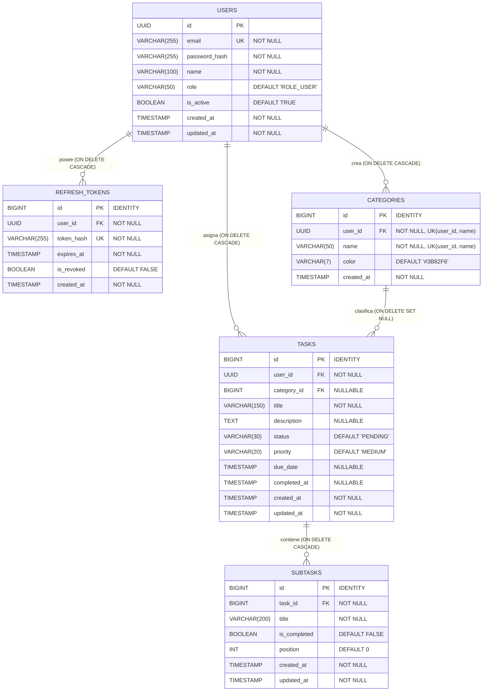

# Base de Datos y Migraciones (Flyway & H2)

El esquema de base de datos está gobernado exclusivamente por **Flyway** (`spring.jpa.hibernate.ddl-auto: none`), utilizando **H2 en memoria** durante el desarrollo y pruebas.

---

## 1. Configuración de Persistencia (`application.yaml`)

| Propiedad | Valor | Descripción |
| :--- | :--- | :--- |
| `spring.datasource.url` | `jdbc:h2:mem:tododb;DB_CLOSE_DELAY=-1;DB_CLOSE_ON_EXIT=FALSE` | Base de datos H2 en memoria persistente mientras la JVM esté activa |
| `spring.datasource.username` | `sa` | Usuario por defecto |
| `spring.datasource.password` | `""` *(vacío)* | Contraseña vacía |
| `spring.h2.console.enabled` | `true` | Habilita la consola web en `http://localhost:8080/api/h2-console` |
| `spring.jpa.hibernate.ddl-auto` | `none` | Desactiva la generación automática de tablas por Hibernate |
| `spring.flyway.enabled` | `true` | Ejecuta las migraciones SQL de `classpath:db/migration` al arrancar |

---

## 2. Diagrama Entidad-Relación (ER)

El siguiente diagrama refleja el esquema definido en [`V1__initial_schema.sql`](../src/main/resources/db/migration/V1__initial_schema.sql):



---

## 3. Diccionario de Tablas

### 3.1. Tabla `users`
Almacena las cuentas de usuario del sistema. Utiliza `UUID` generado en la capa de dominio como clave primaria.

| Columna | Tipo SQL | Nulo | Por Defecto | Restricciones |
| :--- | :--- | :---: | :--- | :--- |
| `id` | `UUID` | No | — | `PRIMARY KEY` |
| `email` | `VARCHAR(255)` | No | — | `UNIQUE` |
| `password_hash` | `VARCHAR(255)` | No | — | Hash BCrypt |
| `name` | `VARCHAR(100)` | No | — | — |
| `role` | `VARCHAR(50)` | No | `'ROLE_USER'` | `ROLE_USER`, `ROLE_ADMIN` |
| `is_active` | `BOOLEAN` | No | `TRUE` | Estado de la cuenta |
| `created_at` | `TIMESTAMP` | No | `CURRENT_TIMESTAMP` | Fecha de creación |
| `updated_at` | `TIMESTAMP` | No | `CURRENT_TIMESTAMP` | Última modificación |

### 3.2. Tabla `refresh_tokens`
Preparada en el esquema inicial para la gestión de sesiones y renovación de tokens JWT.

| Columna | Tipo SQL | Nulo | Por Defecto | Restricciones |
| :--- | :--- | :---: | :--- | :--- |
| `id` | `BIGINT` | No | `IDENTITY` | `PRIMARY KEY` |
| `user_id` | `UUID` | No | — | `FK -> users(id) ON DELETE CASCADE` |
| `token_hash` | `VARCHAR(255)` | No | — | `UNIQUE` |
| `expires_at` | `TIMESTAMP` | No | — | Fecha de expiración |
| `is_revoked` | `BOOLEAN` | No | `FALSE` | Indicador de revocación |
| `created_at` | `TIMESTAMP` | No | `CURRENT_TIMESTAMP` | Fecha de emisión |

### 3.3. Tabla `categories`
Categorías personalizadas por usuario para clasificar tareas.

| Columna | Tipo SQL | Nulo | Por Defecto | Restricciones |
| :--- | :--- | :---: | :--- | :--- |
| `id` | `BIGINT` | No | `IDENTITY` | `PRIMARY KEY` |
| `user_id` | `UUID` | No | — | `FK -> users(id) ON DELETE CASCADE` |
| `name` | `VARCHAR(50)` | No | — | `UNIQUE (user_id, name)` |
| `color` | `VARCHAR(7)` | Sí | `'#3B82F6'` | Formato hexadecimal `#RRGGBB` |
| `created_at` | `TIMESTAMP` | No | `CURRENT_TIMESTAMP` | Fecha de creación |

### 3.4. Tabla `tasks`
Tareas principales asociadas a un usuario y opcionalmente a una categoría.

| Columna | Tipo SQL | Nulo | Por Defecto | Restricciones |
| :--- | :--- | :---: | :--- | :--- |
| `id` | `BIGINT` | No | `IDENTITY` | `PRIMARY KEY` |
| `user_id` | `UUID` | No | — | `FK -> users(id) ON DELETE CASCADE` |
| `category_id` | `BIGINT` | Sí | `NULL` | `FK -> categories(id) ON DELETE SET NULL` |
| `title` | `VARCHAR(150)` | No | — | — |
| `description` | `TEXT` | Sí | `NULL` | Máximo 2000 caracteres en dominio |
| `status` | `VARCHAR(30)` | No | `'PENDING'` | `PENDING`, `IN_PROGRESS`, `COMPLETED`, `CANCELLED` |
| `priority` | `VARCHAR(20)` | No | `'MEDIUM'` | `LOW`, `MEDIUM`, `HIGH`, `URGENT` |
| `due_date` | `TIMESTAMP` | Sí | `NULL` | Fecha límite opcional |
| `completed_at` | `TIMESTAMP` | Sí | `NULL` | Se asigna automáticamente al pasar a `COMPLETED` |
| `created_at` | `TIMESTAMP` | No | `CURRENT_TIMESTAMP` | Fecha de creación |
| `updated_at` | `TIMESTAMP` | No | `CURRENT_TIMESTAMP` | Última modificación |

### 3.5. Tabla `subtasks`
Elementos de checklist dependientes de una tarea principal.

| Columna | Tipo SQL | Nulo | Por Defecto | Restricciones |
| :--- | :--- | :---: | :--- | :--- |
| `id` | `BIGINT` | No | `IDENTITY` | `PRIMARY KEY` |
| `task_id` | `BIGINT` | No | — | `FK -> tasks(id) ON DELETE CASCADE` |
| `title` | `VARCHAR(200)` | No | — | — |
| `is_completed` | `BOOLEAN` | No | `FALSE` | Estado de completitud |
| `position` | `INT` | No | `0` | Orden de visualización ($\ge 0$) |
| `created_at` | `TIMESTAMP` | No | `CURRENT_TIMESTAMP` | Fecha de creación |
| `updated_at` | `TIMESTAMP` | No | `CURRENT_TIMESTAMP` | Última modificación |

---

## 4. Índices de Rendimiento y Consultas Dinámicas JPQL

### Índices Creados en `V1__initial_schema.sql`
- **Refresh Tokens**: `idx_refresh_tokens_user_id`, `idx_refresh_tokens_token_hash`
- **Categorías**: `idx_categories_user_id`
- **Tareas**: `idx_tasks_user_id`, `idx_tasks_user_status`, `idx_tasks_user_due_date`, `idx_tasks_category_id`
- **Subtareas**: `idx_subtasks_task_id`

### Patrón de Filtrado Dinámico en Repositorios JPA
Para soportar filtros opcionales combinables sin ramificar código en Java ni usar `CriteriaBuilder`, los repositorios emplean evaluación nula en JPQL:

```java
// Ejemplo en ITaskRepository
@Query("""
    SELECT t FROM TaskEntity t
    WHERE (:userId IS NULL OR t.userId = :userId)
      AND (:categoryId IS NULL OR t.categoryId = :categoryId)
      AND (:status IS NULL OR t.status = :status)
""")
List<TaskEntity> findAllByFilters(
    @Param("userId") UUID userId,
    @Param("categoryId") Long categoryId,
    @Param("status") TaskStatusEnum status
);
```

